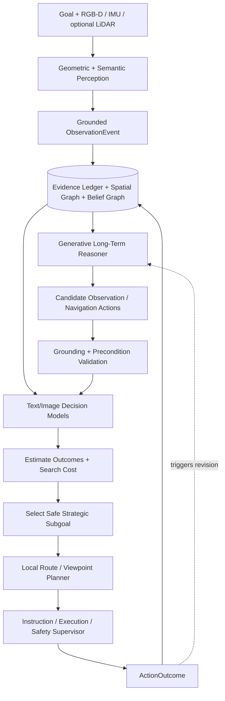

# Technical Implementation Specification
## Hypothesis-Conditioned Active Perception and Multimodal Decision-Making for Map-Free Indoor Navigation

**Version:** 1.0  
**Date:** 13 October 2026  
**Status:** Proposed research architecture; implementation and measured performance not yet established  
**Primary task:** Find arbitrary room identifiers, named offices, or other destinations in unfamiliar multistory buildings **without a preloaded map**.  
**Research objective:** Determine whether a learned multimodal action evaluator, conditioned on competing structural hypotheses, reduces the expected cost of acquiring navigation-relevant evidence and reaching destinations compared with direct LLM planning and conventional semantic exploration.

> **Research claim to test, not assert:** Structured beliefs + active perception + a learned multimodal decision model will outperform simpler planners on held-out buildings. The underlying ideas (active perception, hypothesis testing, uncertainty-aware exploration, value-of-information planning) are established; the candidate contribution is their *specific hypothesis-conditioned action-value formulation, training procedure, and empirical performance on arbitrary-room search*.

---

# 1. Scope and project-specific basis

## 1.1 System behavior

The user says **"Find room 501."** The agent has no floor plan. It senses its surroundings, finds visible room labels and signs, develops competing hypotheses about what numbering means, and chooses **actions whose observations could change which region it should search**. It can request a safe stationary turn, a better view of a sign, a closer inspection of a door, or exploration of an accessible frontier. New evidence corrects the stored beliefs and can trigger a new strategic subgoal. A local tactical planner handles moving to the chosen landmark; the safety layer can stop instructions independently of model calls.

The planning problem is **destination discovery under partial observability**, not merely route finding on a known graph. During a mission, the agent incrementally constructs and revises its own local map.

## 1.2 Basis in the existing project notes

The project notes organize the system into **geometric perception** (LiDAR/depth, SLAM, walls/floors/stairs), **semantic perception** (detection, OCR, sign/symbol interpretation, VLM scene relationships), a **shared observation builder**, **long-term planning** (hypotheses → subgoals → exploration → feedback), **short-term execution with decision models**, and **landmark memory**. Those components are retained here. This specification *adds* formal action contracts, belief revisions, an active-viewpoint action vocabulary, a learned action-value objective, training targets, simulator design, safety invariants, and evaluation protocols; these details are design recommendations rather than content established by the notes.

## 1.3 What is deliberately outside the first research phase

- End-to-end robotics control from pixels to human movement instructions.
- Dependable independent mobility assistance; this requires separate safety assessment and supervised testing.
- Universal floor inference or an all-building pretrained map.
- A continuously streaming flagship LLM call on every video frame.
- Mandatory large-model fine-tuning before any navigation benchmark exists.
- Hardware purchase as a prerequisite for demonstrating the research algorithm.

**First release target:** a reproducible simulator with partial observability, active camera/viewpoint actions, explicit hypotheses, six baselines and test reports. Sensor integration is a later phase.

# 2. System boundaries and architecture

## 2.1 Runtime pipeline



The editable canonical diagram is `system_architecture.mmd`.

## 2.2 Module ownership and update rates

| Module | Inputs | Outputs | Trigger / execution | Grounding authority |
|---|---|---|---|---|
| Sensor acquisition | Camera, depth, IMU, optional LiDAR | Timestamped raw streams | Frame/sample driven | Ground truth only inside simulator |
| Geometric perception | Depth/IMU/frames | Pose, quality, local occupancy, visible geometry | Continuous/local | Sensor-based |
| Semantic perception | Frames, crops, context | Door/sign/room readings, relationships | Detector continuously; VLM selectively | Observation, not inference |
| Observation assembler | Geometry + semantics + timestamp | `ObservationEvent` | New evidence | Links reading to sensor and pose |
| World model | Events and action outcomes | Partial map, known landmarks, versioned hypotheses | Event-driven | Authoritative state store |
| Generative strategic reasoner | Goal + relevant state | Hypotheses, candidate actions, information needs | Relevant new evidence or subgoal completion | **Proposal only** |
| Text decision scorer | Hypothesis summaries + candidate | Outcome/utility estimates | Batch per planning point | Estimate, not fact |
| Image decision scorer | Map crop/scene crop + candidate | Visual feasibility/usefulness estimates | Batch per planning point | Estimate, not fact |
| Action selector | Validated candidates and estimates | One bounded `StrategicSubgoal` | Event-driven | Hard feasibility constraints |
| Tactical and viewpoint planner | Subgoal + local map | Safe route / turn / inspection plan | Recomputed on pose and blockage changes | Known accessible geometry only |
| Safety supervisor | Sensor freshness, hazards, user input | Stop, suppress or release instructions | Independently, locally | **Highest priority** |
| Recorder/evaluator | Every event, state revision, decision | Reproducible trajectory + metrics | Continuous, asynchronous | No feedback to test-time agent from evaluation oracle |

**Design choice:** the generic LLM generates candidate hypotheses and actions; specialized decision models judge bounded claims and/or future action value. Neither can directly write verified facts or override safety.

# 3. Precise problem formulation

## 3.1 Latent state and available observations

Let the hidden environment state be

\[
 s_t = (G^*,R^*,\theta^*,x_t,u_t)
\]

where `G*` is the unknown building graph, `R*` contains true room/wing/floor mappings, `θ*` describes numbering/signage conventions, `x_t` is the user's pose, and `u_t` includes dynamic/accessibility conditions. These are available **only to the simulator**, not the navigation agent.

The agent stores a belief `b_t` over relevant structural claims: candidate floor for the target, candidate wing, room numbering rule family, accessibility of connections and reliability of observed signs. Beliefs need not encode the entire full-building state. They should preserve **unknown** and should support multiple competing explanations.

The observation model is `o_t ~ P(o | s_t, a_{t-1})`. For active viewpoint actions, observation depends on camera position, orientation, occlusion, text size, sensor range and interpretation reliability. In initial perfect-perception mode, observations are correct **if visible**; invisible information remains hidden.

## 3.2 Action vocabulary

Define typed high-level actions:

| Action ID | Parameters | Expected evidence | Preconditions / limits |
|---|---|---|---|
| `rotate_in_place` | signed angle, maximum rotation, body-turn request | New view of sign/corridor | Stationary, consent, safe turning area |
| `scan_intersection` | approved scan pattern | New signs, exits, nearby doors | Safe stationary position |
| `inspect_sign` | grounded sign ID | Text, arrow pairing, floor/range claim | Sign observed, reachable view pose |
| `inspect_room_label` | door ID | Room number, door association | Door visible and safely approachable |
| `approach_viewpoint` | candidate viewpoint ID | Increased text legibility, better 3D visibility | Validated approach route |
| `explore_frontier` | frontier ID, distance/time budget | New reachable graph and observations | Known safe entry path; bounded exploration |
| `navigate_to_connector` | stair/elevator ID | Floor connectivity and labels | Validated accessible route and user constraint |
| `ask_user_or_staff` | bounded query | Direct textual/voice evidence | User permits interaction; source uncertainty tracked |
| `pause_or_request_help` | cause code | None | Always available |

**Critical distinction:** `inspect_sign` is an *information-seeking action* even if it makes no immediate distance progress; `explore_frontier` gathers both geometry and semantics. The model must be allowed to choose both.

## 3.3 Goal verification

Arrival requires an observation linked to a physical doorway/landmark that **matches the requested identifier or verified destination synonym**, plus valid location association; if ambiguous, request confirmation rather than announcing success. Being near the suspected target coordinates or having a highly confident LLM prediction is insufficient.

# 4. Structured world memory and hypotheses

## 4.1 Physical and semantic representation

Use three connected stores, all reconstructed from an append-only evidence/outcome ledger:

1. **Metric/submap layer**: local occupancy/traversability, poses, transforms, uncertainty and visited traversals; per-floor segments are possible but must not imply verified floor labels.
2. **Topological/semantic layer**: stable IDs for corridor junctions, doors, room labels, elevator lobbies, stairs, directories, signs, frontiers, and edges with status `known_accessible`, `blocked`, `unknown`.
3. **Belief/evidence layer**: propositions about room numbering, target floor/wing/region, sign reliability, hypothesized graph links and contradictions.

Suggested SQLite tables: `events`, `observation_artifacts`, `poses`, `landmarks`, `connections`, `facts`, `hypotheses`, `hypothesis_support`, `hypothesis_dependencies`, `actions`, `outcomes`, `snapshots`.

Use **content-addressed image references** and local retention controls where privacy requires it. Maintain `schema_version`, `map_revision`, and immutable `evidence_id` for all derived entries.

## 4.2 Hypothesis schema

A hypothesis should have a scoped proposition, provenance, an update rule, and dependency links. Suggested hypotheses:

- `H1`: *For wing A, leading room digit indicates floor.*
- `H2`: *In this building, leading room digit indicates wing instead.*
- `H3`: *Room 501 is on local vertical level 5.*
- `H4`: *Room 501 is in wing 5.*

`H3` may depend on `H1` and a room-label observation. If `H1` is contradicted, `H3` must be reconsidered, not remain silently asserted.

Do **not** assign arbitrary confidence figures generated by an LLM. MVP may use evidence statuses `proposed`, `supported`, `contradicted`, `retracted`, `confirmed`. Numeric beliefs require a clearly specified estimation model and later calibration.

## 4.3 Multi-parent provenance and contradictions

A hypothesis can have several independent or correlated supports: room labels, directories, signs, floor displays, user observations. Store evidence IDs and dependency types rather than flattening everything into one prose summary. A reading from OCR and a VLM interpretation of **the same crop** are correlated; treat them as two estimators of one underlying observation, not independent evidence to multiply blindly.

For explicit discrete hypotheses `h`, a possible update is

\[
 b_{t+1}(h) \propto P(o_t\mid h,a_t)\,b_t(h)
\]

but only if outcome likelihoods have been modeled. Start with a deterministic truth-maintenance mechanism and categorical belief tracking; learn likelihoods during the simulator stage. Retain rejected and contradicted hypotheses for replay and failure analysis.

## 4.4 Relevant context retrieval

At each strategic decision, retrieve the small set of facts relevant to the goal, current location, likely floors/wings, reachable inspection landmarks, and prior failed attempts. Send a **versioned snapshot**, not blindly the entire raw episode transcript. For comparison, implement full-history LLM as a baseline with the same available observations.

# 5. Active perception and viewpoint geometry

## 5.1 Visibility model in simulation

Define camera pose `T_WC`, intrinsics/FOV, a head/torso occlusion model if relevant, and renderer visibility queries. A sign is *detected* only if it projects into view, is not blocked and meets an applicable size/contrast threshold. A sign is *readable* only under separate stricter conditions (distance, angle, pixel height, blur and lighting). In MVP **oracle semantic mode**, correctness of recognized readable text is 100%, but text beyond the readable threshold is unavailable.

For a point `p_W`, transform to camera coordinates and project using intrinsics. Check visible ray along environment mesh/segments and `depth_valid`. Grounded observation events attach the physical landmark ID and crop (real images) or source geometry (simulator).

## 5.2 Active perception planner

1. Identify **uncertainty that matters to the current destination** (target floor, wing, numbering convention, correct corridor, sign content).
2. Enumerate feasible *observation actions* at the current location (turn left/right, look at directory, change vantage) and feasible *navigation actions* (approach sign, explore frontage, take elevator).
3. Predict which outcomes each action could return, its expected effort, and how it would change future search strategy.
4. Select one bounded action with an expected-observation stop condition; observe the result and update the belief graph.

Viewpoint generation should never use the simulator's hidden ground-truth room location. Its raycasting knowledge must correspond to geometry already mapped as known; expected visibility in unknown regions should be estimated probabilistically or marked unknown.

## 5.3 Simple initial camera profile (proposed engineering assumption)

Start with a chest camera at 1.35 m, 10° down, approximately 80° horizontal and 55° vertical FOV, then vary FOV, pitch, readability limits and body turns. This is a **test preset**, not a claim that the final wearable hardware is optimal. Add optional 2D LiDAR and downward camera profiles later. Use the dedicated sensor positioning specification from this project for physical mounting/calibration details.

# 6. Hypothesis-conditioned action-value decision model

## 6.1 The proposed primary research contribution

A generative planner proposes what *could* be true and what the agent could inspect. The action-value model learns to estimate **how useful an observation action is for completing the navigation task** given the currently competing structural hypotheses.

Inputs to the evaluator:

- `goal_embedding / destination_identifier`: `Room 501` and normalized intent.
- `b_t`: structural hypotheses, dependencies, support and uncertainty.
- `G_t`: compact known subgraph and route distances.
- `I_t`: optional visual map and camera crop(s), spatially referenced.
- `a`: one candidate action, grounded target, predicted travel/turn/inspection burden.
- `history_summary`: relevant failed inspections, contradictory observations and previous subgoals.

Outputs, with distinct calibration:

- `p_observation_available`: probability action produces usable evidence.
- `p_distinguishing`: chance the observation separates competing structural hypotheses.
- `predicted_outcome_distribution`: optional discrete sign/floor/room categories plus `unknown`.
- `estimated_cost_to_go`: expected remaining navigation cost after taking action and updating belief.
- `epistemic_uncertainty`: variability/insufficient training coverage for the estimate.

The first three may be provided by specialized zero-shot **text/image decision APIs**. They are not automatically an action-value function: a learned, environment-specific model or explicit planning is needed to connect their predictions to *downstream search cost*.

## 6.2 Decision objective

A one-step belief-space action is selected by minimizing

\[
 a^*=\arg\min_{a\in\mathcal A_{\mathrm{feasible}}}
 \left[C(a)+\mathbb{E}_{o\sim P(o\mid b_t,a)}V(b_t^{a,o},g)\right]
\]

where `C(a)` accounts for travel, time, orientation/human effort and interaction burden. `V(b',g)` is the expected remaining cost to a *verified* destination under the updated belief. Feasibility includes hard constraints on safe traversability and user accessibility; safety should not be a small additive penalty.

The **learned surrogate** is

\[
 Q_\theta(b_t,G_t,I_t,a,g)\approx C(a)+\mathbb E_o V(b_t^{a,o},g).
\]

Select the minimum **validated** value; optionally add an uncertainty penalty for out-of-distribution states. In early experiments compare it to a heuristic one-step information-gain score and a direct VLM ranker. The research hypothesis is that cost-to-go conditioned on structural hypotheses selects observations with greater downstream usefulness than raw uncertainty or semantic frontier score alone.

### 6.3 Computational progression

**Baseline 0 — Greedy:** nearest accessible frontier or nearest inspectable label.  
**Baseline 1 — Semantic:** goal-relevance heuristic from room ranges and signage.  
**Baseline 2 — Structured information gain:** hand-specified likelihoods plus one-step entropy reduction.  
**Proposed 1 — Model scoring:** specialized text/image model estimates usefulness or outcomes; explicit cost rule selects action.  
**Proposed 2 — Learned cost-to-go:** train `Q_theta` on simulator-derived rollouts; text+image inputs, belief graph, candidate action.

This progression lets the team produce a working algorithm without first training a complex VLM or POMDP solver.

# 7. Training the specialized multimodal model

## 7.1 Dataset generation without oracle leakage

Procedurally generate **latent ground truth** buildings with varied numbering rules, signs, connector layouts, distractions, occlusion and inconsistent conventions. Execute the same agent policy on each environment to produce *observable* state histories. At selected decision points, fork the simulator to evaluate each legal candidate action and run one or more continuation policies with multiple seeds.

- **Model feature `X`**: only the history and state the agent actually had before taking action `a` (including allowed visible crops).
- **Training target `Y`**: observed rollout total task cost or measured improvement in cost-to-go after action `a` (computed offline using simulator truth, **never supplied as inference input**).
- **Categorical outcomes**: whether a sign was readable, whether an action separated target-floor hypotheses, whether navigation eventually succeeded within budget.
- **Invalid actions**: flagged and excluded from ranking/training as plausible navigation actions; optionally train a separate constraint detector.

For each candidate `a`, compute

\[
 \hat Q(b,a,g)=\frac{1}{K}\sum_{k=1}^K \left[c_a^{(k)}+\text{remaining\_episode\_cost}^{(k)}\right].
\]

Record uncertainty across continuation samples. This target depends on the **continuation policy**. To compare methods fairly, use a fixed and disclosed rollout policy; consider stronger lookahead targets later. Label a navigation decision informative if it changes optimal/near-optimal destination-search action, not merely if it produces a novel image.

## 7.2 Example training record

```json
{
  "episode_id": "train-building-0084",
  "decision_step": 11,
  "goal": "room 501",
  "world_state_ref": "state-011",
  "hypothesis_ids": ["h-floor-prefix", "h-wing-prefix"],
  "candidate_action": {"kind": "inspect_sign", "target_id": "directory-02"},
  "route_cost_m": 4.5,
  "visible_image_ref": "crop-112",
  "labels": {
    "observation_usable": 1,
    "hypotheses_distinguished": 1,
    "mean_total_cost_to_goal": 52.0,
    "rollout_count": 24
  },
  "data_split": "train",
  "note": "Example values only; not an experimental result."
}
```

## 7.3 Model architecture options

- **Text-only baseline:** concatenate bounded features (graph statistics, hypothesis statuses, action type) into a text encoder and regress expected cost / classification probabilities.
- **Graph-aware lightweight model:** encode floor/wing/landmark graph with GNN or handcrafted features; combine with text embedding for rule descriptions.
- **Multimodal scorer:** frozen text encoder + image encoder for map/crop, small fusion MLP with action features; train a multi-head output (`p_useful`, `p_discriminative`, `Q`), calibrated afterward.
- **Large decision-model API:** score bounded predicates and candidate visual evidence without updating weights; use it as a comparator or weak labeling source, not as the sole scientific contribution.

Run the first trained model on the Mac mini if feasible (PyTorch CPU/MPS or MLX-compatible modules); avoid committing to large foundation-model fine-tuning until small models and heuristics have been compared.

## 7.4 Losses and calibration

Suggested loss for a multi-task scorer:

\[
 \mathcal L=\lambda_Q\,\mathrm{Huber}(\hat Q,Q^{rollout})+
 \lambda_U\,\mathrm{BCE}(\hat p_{usable},y_{usable})+
 \lambda_D\,\mathrm{BCE}(\hat p_{dist},y_{dist})
\]

Record target scale and cost units; normalize before regression and invert at runtime. Calibrate probabilities on a **validation** split with temperature/isotonic scaling as justified. Report Brier score, reliability plots and ECE along with navigation performance. Correlated text/image model outputs must not be treated as independent likelihood factors without testing.

## 7.5 Dataset split and generalization

Hold out **building-generator families**, not just episode seeds. E.g. train on conventional floor-prefix layouts, validate on mixed wing+floor schemes, test on buildings with split wings, irregular room ranges and ambiguous ground-floor conventions. Keep simulator-generated exact test maps and labels outside prompts and training. Limit model calls per episode so comparisons are not determined only by spending more inference tokens.

# 8. Typed software interfaces

## 8.1 Observation and hypothesis contracts

```python
from enum import Enum
from typing import Literal
from pydantic import BaseModel, Field

class ObservedPose(BaseModel):
    frame_id: str
    x_m: float
    y_m: float
    z_m: float = 0.0
    heading_rad: float
    covariance_ref: str | None = None

class ObservationEvent(BaseModel):
    schema_version: int = 1
    event_id: str
    timestamp_ns: int
    kind: Literal["room_label", "sign", "floor_label", "door", "frontier", "hazard", "user_input"]
    landmark_id: str | None = None
    value: str | None = None
    pose: ObservedPose
    source_artifact_ref: str | None = None
    recognition_score: float | None = Field(default=None, ge=0, le=1)

class HypothesisStatus(str, Enum):
    PROPOSED = "proposed"
    SUPPORTED = "supported"
    CONTRADICTED = "contradicted"
    RETRACTED = "retracted"
    CONFIRMED = "confirmed"

class StructuralHypothesis(BaseModel):
    hypothesis_id: str
    proposition: str
    scope: str
    status: HypothesisStatus
    supporting_event_ids: list[str] = Field(default_factory=list)
    contradicting_event_ids: list[str] = Field(default_factory=list)
    depends_on: list[str] = Field(default_factory=list)
    probability: float | None = Field(default=None, ge=0, le=1)
```

These example classes are illustrative. Production contracts should add cross-field validators, time-unit checks and schema migration support.

## 8.2 Candidate, estimate, subgoal and outcome

```json
{
  "candidate_id": "cand-9",
  "kind": "inspect_sign",
  "target_id": "directory-02",
  "why": "Distinguish floor-prefix from wing-prefix hypothesis",
  "required_evidence": ["floor_range_mapping"],
  "predicted_travel_m": 4.5,
  "max_duration_s": 100,
  "map_revision": 14
}
```

A `DecisionAssessment` stores `candidate_id`, per-head outcome estimates, cost-to-go estimate in explicit units, model version, calibration version, uncertainty bounds, refusal/failure status and inference latency.

A `StrategicSubgoal` includes `subgoal_id`, validated action type and landmark, `map_revision`, supported hypotheses, expected evidence, travel/time budget and termination codes (`evidence_obtained`, `route_blocked`, `unsafe`, `user_cancelled`, `timed_out`). An `ActionOutcome` includes realized cost, newly observed evidence IDs, success/failure status and reason for termination. The same contracts are used by all baselines.

## 8.3 Model provider abstraction

Define `generate_hypotheses(snapshot)`, `propose_candidates(snapshot)`, `score_text_predicates(snapshot, candidates)`, and `score_visual_predicates(snapshot, crops, candidates)` as distinct adapter functions. A direct LLM landmark policy can implement `choose_subgoal(snapshot)`. Provider APIs can change; **do not assume a vendor-specific score is calibrated navigation probability**. Handle failed calls with explicit errors, timeouts and local fallback. Send only relevant crops under applicable privacy controls.

# 9. Main decision loop and failure behavior

## 9.1 Execution pseudocode

```python
async def strategic_tick(goal, store, generator, scorers, selector, executor):
    # Called on new mission or informative event, not every video frame.
    snapshot = await store.retrieve_goal_relevant_snapshot(goal)
    await store.revise_hypotheses_from_new_evidence(snapshot)

    candidates = await generator.propose_actions(snapshot)
    candidates = validate_grounded_actions(candidates, snapshot)
    if not candidates:
        return await executor.pause_and_request_help("no_valid_action")

    # Can be zero-shot decision APIs, locally trained Q model, or heuristic baseline.
    estimates = await scorers.score_batch(snapshot, candidates)
    selected = selector.min_expected_cost(candidates, estimates, snapshot)
    if selected is None:
        return await executor.pause_and_request_help("no_safe_action")

    outcome = await executor.execute_bounded_subgoal(selected)
    await store.append_action_outcome(outcome)
    # Observation events flow independently from the sensor/perception channel.
    return outcome
```

Implement the long-term state machine as `WAITING → DELIBERATING → EXECUTING → VERIFYING → (REPLAN | ARRIVED | PAUSED)`. Make repeated failed actions visible to the planner; cap retry loops and no-progress exploration. A model's request to inspect a landmark that does not exist must be rejected rather than silently fabricated.

## 9.2 Safe failure handling

| Condition | Expected behavior |
|---|---|
| Stale pose / unknown traversability | Stop motion guidance; retain last valid world state without asserting free space |
| OCR and VLM disagree on room number | Store conflict tied to original crop; request different view / user confirmation |
| Hypothesis contradicted by directory | Revise dependent claims, record the contradiction, replan |
| Candidate target ID unknown or map revision stale | Reject action, refresh state, optionally regenerate once |
| LLM/decision API timeout | Preserve on-device stop/pause/help; do not improvise ungrounded exploration |
| Repeated no-progress cycles | Terminate/ask assistance, report unresolved uncertainty |
| User declines turn / stairs / elevator | Remove action from feasible set; seek accessible alternative |
| Destination label not verifiable | Report probable location as unverified; do not declare arrival |

# 10. Simulator implementation (critical path)

## 10.1 Step 1: topological procedural environment

Generate latent full-building graphs: floors (1–8), corridors, intersections, doors, numbered rooms, wings, stairs, elevators, signs and directories. Attach per-building latent rules and exception policies. An environment has explicit ground truth for generating observations and evaluating a finished episode; the **agent only receives visited/visible partial graph**.

Include: floor-prefix numbering, wing-prefix numbering, split floors, basement/ground labels, repeated room suffixes, inconsistent signage, blocked connector, room ranges separated by wings, occluded signs, and corridors ending without target access.

## 10.2 Step 2: visibility-aware virtual camera

Simulate RGB-D observation reach with a 2D/2.5D ray model first: camera FOV, yaw/pitch, line-of-sight, sign projected size, readable distance, and pose. Add `rotate_in_place`, `scan_intersection`, and `approach_viewpoint` actions, each with an actual time and effort cost. Reveal unreadable sign as an *unreadable-sign observation* rather than its hidden text. This is essential for active-perception studies.

## 10.3 Step 3: tactical movement and action costs

The geometric agent uses A* on known accessible edges and terminates at a bounded viewpoint/frontier. In simulation a `change_floor` skill is only legal when the relevant connection has been discovered and its accessibility verified. Charge time/distance for route traversal, view turning, reading, asking and repeated inspections. For early research, use a consistent simulated pedestrian speed; treat it as a controlled parameter.

## 10.4 Step 4: noise and eventually images

Add OCR swaps (e.g. 1 vs 7), missed signs, wrong arrow associations, pose drift, dynamic obstacles, and sensor dropouts. Use a photorealistic simulator such as Habitat/Isaac only once the algorithm works and realistic visual effects are necessary. The same `ObservationEvent` contract should support synthetic and real data without changing the strategic planner.

## 10.5 Testing observability and anti-leakage

For each action, assert:

- No observation includes a landmark outside camera FOV or behind an opaque obstacle.
- No planner state contains latent `full_building_graph`, `true_numbering_rule` or `true_target_location` fields.
- Expected travel distance is computed from the **known** graph only, except for evaluator-only optimal path metrics after the episode.
- Simulator forks for training labels cannot write their hidden outcomes into the test-time belief state.
- Given seed + episode inputs + stored model responses, the decision trace is replayable.

# 11. Benchmark design and scientific evaluation

## 11.1 Primary baselines and controlled ablations

| ID | Hypothesis graph | Active viewpoints | Specialized decisions | Action selector |
|---|---|---|---|---|
| **B0** | No | No | No | Nearest frontier |
| **B1** | No | No | No | Semantic frontier heuristic |
| **B2** | No explicit belief graph | Yes | General VLM only | VLM directly selects landmark/view |
| **B3** | Yes | No | No | LLM-guided subgoal selection |
| **B4** | Yes | Yes | No | Explicit one-step information gain |
| **B5** | Yes | Yes | Zero-shot text/image decision scorers | Rule-based expected cost |
| **P** | Yes | Yes | **Trained multimodal cost-to-go scorer** | Constrained minimum predicted cost |

For novelty claims, the decisive comparison is **P versus B4 and B5**, not merely P versus nearest frontier. Compare a text-only trained scorer and multimodal scorer to determine whether images contribute beyond the spatial graph.

## 11.2 Controlled evaluation dimensions

- **Task complexity:** floor count, wings, corridor branching, room-number collisions, remote destinations.
- **Rule novelty:** seen versus held-out numbering systems; exceptions to learned conventions.
- **Information availability:** readable vs hidden directory, sign placement, ambiguity and occlusion.
- **Observation accuracy:** perfect-if-visible → controlled perception errors → recorded real-world captures.
- **Reasoner choice:** same flagship model for policy variants; multiple models as robustness check.
- **Budget:** matched candidate-set size, action and observation capabilities, and inference-token/cost limits.

## 11.3 Metrics

**Primary:** verified success rate, total navigation cost (distance + time + inspection/user burden), excess-distance ratio against full-map evaluator shortest feasible route.

**Secondary:** wrong-floor trips, sign/door inspection count, body-turn burden, redundant corridors, time to correct floor, uncertainty reduction about *target*, belief contradiction recovery delay, API inference cost and p95 model latency, invalid-action rejection and local safety stops.

Report 95% paired bootstrap confidence intervals across held-out **buildings** rather than treating correlated episodes from the same building as independent. Measure subgroups for unseen rule families and misleading signs. Include explicit failure traces and cases where the method is worse than the baseline.

## 11.4 Suggested research acceptance criteria (provisional, not measured)

- G1: all observation and subgoal contracts validated in CI; zero oracle-leak violations.
- G2: baselines B0–B2 operate reliably on deterministic solvable simulator episodes.
- G3: B4 has the expected qualitative behavior (e.g., inspect directory rather than blindly go to floor 5 when informative and cheap).
- G4: trained scorer achieves useful ranking/cost prediction on held-out *building families*, with calibrated uncertainty.
- G5: proposed P demonstrates statistically defensible gains (or honestly reports no improvement) in a predeclared primary metric against B4/B5.
- G6: real-world sensing tests run supervised with local stop behavior and documented failures; no claims of safe independent mobility.

# 12. Repository and software stack

```text
hypothesis-nav/
├── pyproject.toml
├── configs/                 # simulator, model and experiment YAML
├── schemas/                 # validated events, hypotheses and actions
├── sim/                     # graph generator, visibility, actions, rollout forks
├── perception/              # observation abstraction; later real sensors
├── world_model/             # evidence ledger, semantic graph, belief revision
├── strategic/               # task manager, hypothesis generator, candidate policies
├── active_perception/       # viewpoints, visibility proposals, action preconditions
├── decision_models/         # provider adapters, text-only and multimodal Q scorers
├── tactical/                # A*, subgoal state machine, progress monitoring
├── safety/                  # independent stop/pause/assist
├── datasets/                # trajectories + training targets + split manifests
├── training/                # rollout labeling, feature extraction, train, calibrate
├── evaluation/              # baselines, ablations, metrics, reports
├── ui/                      # episode replay visualization
└── tests/                   # unit, integration, scenario and leakage tests
```

**Initial technologies:** Python 3.12+, Pydantic, NetworkX, SQLite, NumPy, PyTorch or MLX-compatible small-model training, pytest, property-based tests, Matplotlib/Plotly for experiment plots. Introduce ROS 2, a 3D simulator, a mobile app or hardware drivers only when real perception and assisted walking become part of the critical path.

**Deployment separation:** local sensing, routing and safety; optional networked large strategic LLM and decision model. In the first research prototype everything can run on a Mac mini except external foundation-model inference.

# 13. Development phases and prioritized tickets

**Planning assumption:** three contributors, roughly 10–15 hours/week each. This is a target schedule, not an estimate of guaranteed completion.

| Phase | Weeks | Engineering work | Exit demo |
|---|---|---|---|
| **0. Foundation** | 1–2 | Versioned schemas, event ledger, building graph primitives, seeds/CI, policy interfaces | Deterministic event replay |
| **1. Simulator + baselines** | 3–5 | Buildings, signage/numbering, camera FOV/occlusion, viewpoints, A*, frontiers | Find room 501 in unknown generated building |
| **2. Belief agent** | 6–8 | Hypothesis generator, evidence dependencies, contradiction revision, B3/B4 | Directory observation corrects wrong floor inference |
| **3. Decision models** | 9–12 | Rollout forks, supervised target labels, zero-shot text/image scoring, lightweight Q model | Compare B4/B5/P on held-out layouts |
| **4. Generalization study** | 13–16 | Held-out rule families, noise, ablations, calibration, paired metrics, reproducibility | Draft research findings and figures |
| **5. Real perception bridge** | 17–21 | RGB-D recordings, OCR, sign association, SLAM map update, event bridge | Replay real building captures through planner |
| **6. Wearable supervised prototype** | 22+ | Phone/edge compute, haptic/voice, independent local stop, field protocol | Controlled supervised demo only |

## 13.1 The first 15 concrete engineering tickets

1. Create `BuildingGraph` generator with hidden full ground-truth representation.
2. Add observable `AgentKnownGraph` with only discovered map edges.
3. Implement a `RoomNumberingRule` interface with multiple conventions.
4. Add signs and directories as separately inspectable landmarks.
5. Add camera FOV, line-of-sight and readability checks.
6. Implement `rotate_in_place` and `inspect_sign` actions with measured cost.
7. Implement A* routes over known edges and a bounded exploration skill.
8. Define/validate `ObservationEvent` and `ActionOutcome` contracts.
9. Add append-only SQLite event ledger with replay support.
10. Implement B0 and B1 baselines with metrics.
11. Implement `StructuralHypothesis` plus dependencies and contradiction invalidation.
12. Add a generative model adapter for candidate actions and stable IDs.
13. Implement B4 expected-information heuristic on a discrete candidate-floor belief.
14. Build simulator rollout-fork labeling for candidate action value.
15. Train and benchmark a small text-only Q scorer before adding image inputs.

**Week-1 acceptance scenario:** In a building with a visible room-112 plaque and only a partially visible elevator directory, a scan or short sign inspection exposes new evidence; the agent does not know the directory text in advance.

# 14. Risks, controls, and common mistakes

| Failure mode | What causes it | Mitigation / test |
|---|---|---|
| **Artificial novelty** | Renaming POMDP or semantic-frontier methods | Cite precedents; predefine P vs B4/B5 experiments |
| **Oracle leakage** | Hidden building used in prompts/actions | Separate simulator truth and agent-visible data structures |
| **Spurious action values** | Train/test share procedural rules | Hold out generator families; analyze OOD calibration |
| **Incorrect probabilities** | Raw model confidence used as likelihood | Calibration and refusal/uncertainty handling |
| **Evidence double counting** | OCR and VLM use same crop | Shared evidence reference, correlated-source tracking |
| **Overly expensive lookahead** | Fork every action at runtime | Train surrogate offline, cap candidates, one-step fallback |
| **Endless deliberation** | No stop condition or progress metric | Bounded subgoals, retries, no-progress termination |
| **Sensor omniscience** | Signs revealed outside FOV or through walls | Visibility-and-legibility unit tests |
| **Safety bypass** | Generative action commands passed to device | Typed validator and independent local safety gate |
| **False arrival** | Predicted location mistaken for confirmed room | Grounded door-label verification and user confirmation |
| **Human effort ignored** | Agent asks for constant turns/scans | User-burden term and separate metrics |

# 15. Research positioning and source references

**Established prior art:** ReasonNav demonstrates room/sign/landmark-driven VLM navigation; HGR already predicts and corrects frontier semantics; Atanasov et al. formulated nonmyopic view planning as active hypothesis testing using POMDP ideas. Therefore **hypothesis testing + active perception alone is not a novel claim**.

**Candidate distinct contribution:** learning a *hypothesis-conditioned, multimodal approximation of downstream navigation cost* for deciding **which observation a map-free arbitrary-room search agent should actively acquire**, including stationary viewpoint actions, building-level numbering conventions and human movement burden. Novelty requires a systematic prior-art search and experimental validation.

### References

1. **Project source:** *autonomous planning*, planning and perception notes, user-provided working document, pp. 4–8. This document preserves its geometric/semantic perception split, long-term hypothesis/subgoal loop, short-term decision-model goal, and landmark-memory concept.
2. **ReasonNav:** *Human-like Navigation in a World Built for Humans* (CoRL 2025), https://arxiv.org/abs/2509.21189 — map/landmark memory, room labels and signs.
3. **Hypothesis Graph Refinement:** Chen et al., *Hypothesis-Driven Exploration with Cascade Error Correction for Embodied Navigation* (2026), https://arxiv.org/abs/2604.04108 — predicted frontier semantics, belief dependencies and retraction.
4. **Nonmyopic View Planning for Active Object Detection:** Atanasov et al., https://arxiv.org/abs/1309.5401 — active hypothesis testing with mobile depth camera and approximate POMDP.
5. **OpenAI Decisions API:** https://developers.openai.com/api/docs/guides/decisions — an example of an optional typed text-and-image scorer; API version/model compatibility and task-specific calibration must be checked at integration time.
6. **Procedural simulator options:** Habitat-Lab https://github.com/facebookresearch/habitat-lab; ROS Nav2 https://docs.nav2.org/ — for later embodiment/robotics comparisons rather than prerequisites for the graph simulator.

---

## Definition of research success

The strongest possible finding would be: **At matched perception, action inventory, and reasoning budget, a hypothesis-conditioned multimodal action-value policy reduces search cost and/or increases verified destination success on unseen building organizations relative to both a hand-designed information-gain planner and a direct multimodal-LLM planner.** If the learned policy does not improve those results, the architecture still yields a useful negative study identifying when explicit beliefs or active viewpoints help—and when specialized decision models are unnecessary.
